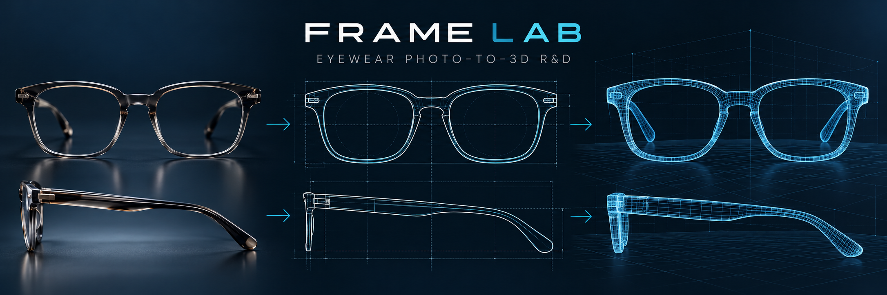

# Md Abdul Kuddus

**Software engineer building AI-powered products, SaaS platforms, and commerce tools.**

I work across interfaces, APIs, integrations, and deployment to turn product ideas into working software. Over six years in software engineering, I have shipped customer-facing products and the systems behind them. At Startise and WPDeveloper, I worked on Templately's live AI generation and editing features alongside its storefront, services, and internal tools.

Today my work spans Python-based computer vision research, Shopify products, and SaaS applications. I use AI-assisted and agentic development workflows to move faster while staying responsible for implementation, review, and delivery.

[Portfolio](https://dekuddus.dev) · [LinkedIn](https://www.linkedin.com/in/dekuddus/) · [Email](mailto:ma.kuddus37@gmail.com)

## Selected work

| Project | What I built or contributed to |
| --- | --- |
| [Templately](https://templately.com) | Production AI site and template generation and editing, real-time progress feedback, a Next.js storefront, Laravel/GraphQL APIs, and internal tools. |
| [Frame Lab](https://dekuddus.dev/projects#frame-lab) | Python eyewear reconstruction research: product photos and measurements become reviewed outlines and a CPU-generated 3D GLB for browser inspection and AR. Optional AI segmentation assists analysis. **Research app; no public demo.** |
| [Poby](https://getpoby.com) | Live Shopify app that collects post-purchase ratings and written feedback through a Thank You page extension, with a merchant analytics dashboard. |
| [Postli](https://usepostli.com) | Shopify marketing product for tracked short links, social scheduling, click analytics, and order-based revenue attribution. |
| [RepairSuite](https://repairsuite.co.uk) | Repair-shop platform covering tickets, technician workflows, parts inventory, invoicing, multi-branch operations, and reporting. Built with Technetc. |
| [BiteKube](https://bitekube.com) | Restaurant ordering and POS workflows, including online checkout, dine-in and pickup sales, back-office management, and real-time order updates. Built with Technetc. |
| [SalGenie Virtual Try-On & Size Chart](https://vto.salgenie.com/) | Shopify app in development for photo-based try-on previews, size charts, size recommendations, and merchant analytics. The linked product preview is live. |

## Tools I use

- **AI and Python:** Python, computer vision, optional model-assisted segmentation, LLM integrations, AI-assisted development workflows
- **Product engineering:** TypeScript, JavaScript, React, Next.js, Shopify, GraphQL, Tailwind CSS
- **Backend and operations:** PHP, Laravel, Node.js, MySQL, PostgreSQL, Redis, Docker, Git, CI/CD

I'm interested in hands-on AI product engineering and full-stack roles where I can ship useful features with a product team.

**More details and project status:** [dekuddus.dev/projects](https://dekuddus.dev/projects)
